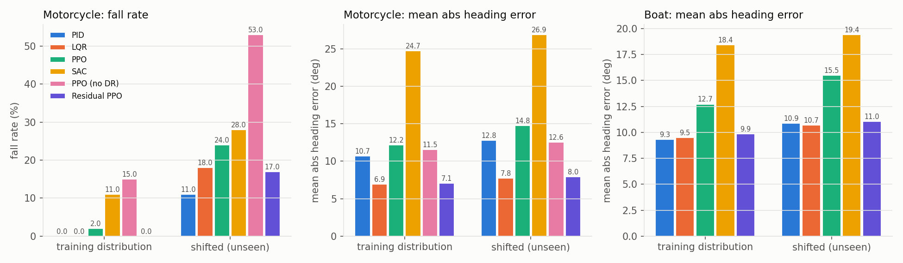
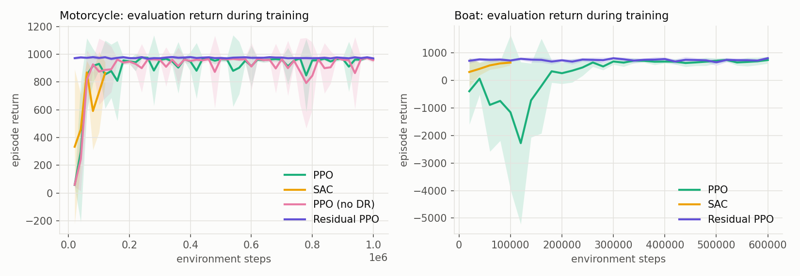
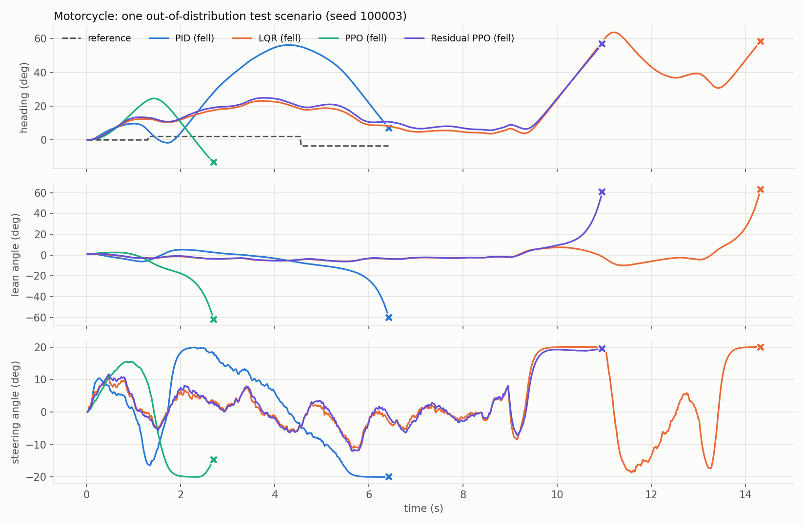
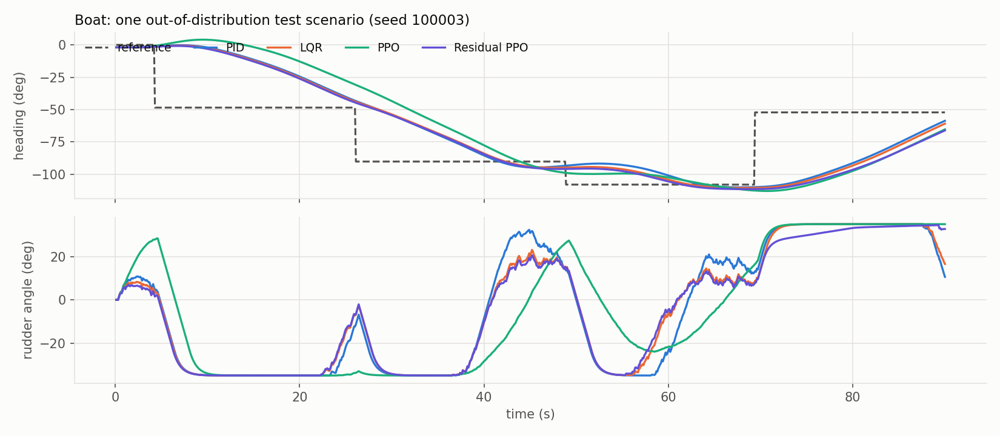

# Deep RL for Motorcycle & Marine Vessel Control

Deep reinforcement learning controllers (PPO, SAC) for two mobility platforms, trained in physics simulators with **domain randomization** and benchmarked against **tuned PID and LQR** controllers on identical test scenarios, including a harder, out-of-distribution test set. Policies are exported to **ONNX** for real-time inference.

| Platform | Control task | Actuator | Main difficulty |
|---|---|---|---|
| Two-wheeler (motorcycle) | Stay upright and track heading changes of up to ±45° at 2.5–14 m/s | Steering angle (±20°) | Open-loop unstable; you must counter-steer to turn; little steering authority at low speed |
| Boat | Hold and change heading (±60° course changes) | Rudder (±35°, rate-limited to 15°/s) | Slow, sluggish response, wind/current bias, waves, servo lag |

<!-- RESULTS -->
## Results

**RL did not beat tuned classical control on these tasks.** End-to-end PPO and SAC lose clearly to the tuned baselines. Residual PPO on top of LQR essentially matches LQR, and its main measurable gain is smoother actuation: 14–25% lower action rate, at the cost of about 0.2–0.4° more heading error.

100 episodes per cell, same seeds for every controller. Each cell is training distribution / shifted test set. Best return in each column group is in bold.

| Env | Controller | Mean return | Mean abs heading error (°) | Fall rate (%) | Action rate (1/s) |
|---|---|---|---|---|---|
| Motorcycle | PID | 960.1 / **888.7** | 10.73 / 12.78 | 0 / 11 | 1.30 / 1.21 |
| | LQR | **974.0** / 870.3 | 6.92 / 7.76 | 0 / 18 | 2.48 / 3.78 |
| | Residual PPO | **974.0** / 872.8 | 7.09 / 7.95 | 0 / 17 | 1.85 / 3.02 |
| | PPO | 947.0 / 758.3 | 12.18 / 14.76 | 2 / 24 | 1.83 / 3.70 |
| | PPO (no DR) | 879.9 / 589.6 | 11.55 / 12.55 | 15 / 53 | 1.21 / 2.40 |
| | SAC | 790.0 / 646.8 | 24.72 / 26.90 | 11 / 28 | 6.11 / 7.40 |
| Boat | PID | 734.2 / 710.6 | 9.33 / 10.89 | 0 / 0 | 0.99 / 1.63 |
| | LQR | **734.3** / **713.0** | 9.49 / 10.72 | 0 / 0 | 0.97 / 1.68 |
| | Residual PPO | 731.7 / 710.8 | 9.87 / 11.04 | 0 / 0 | 0.81 / 1.44 |
| | PPO | 694.3 / 632.9 | 12.72 / 15.49 | 0 / 0 | 0.21 / 0.28 |
| | SAC | 601.2 / 567.7 | 18.43 / 19.42 | 0 / 0 | 2.34 / 2.41 |

What the numbers show:
- **Residual vs LQR:** on the shifted motorcycle set, falls go from 18 to 17 episodes, which is one seed and not a meaningful difference. Boat return is slightly lower (about 0.3%).
- **Best on the shifted motorcycle set:** PID has the highest return and fewest falls (11%), but LQR and Residual PPO track heading about 5° more accurately.
- **Residual vs end-to-end PPO:** on the shifted motorcycle set, the residual policy cuts falls from 24% to 17% and heading error from 14.76° to 7.95°. It also trains from a stable controller from the first step (see learning curves).
- **Domain randomization:** on the shifted motorcycle set, PPO falls 24% of the time with DR and 53% without.

Caveats:
- Heading error and action rate are averaged only over episodes without a fall, so compare them alongside fall rate. Mean return covers all episodes.
- Each agent was trained with a single seed.
- SAC had far fewer steps than PPO (120k vs 1M on the motorcycle, 100k vs 600k on the boat), so this is not a fair PPO vs SAC comparison.

**ONNX deployment** (`results/onnx_benchmark.json`): all six exported policies match PyTorch to within 3.7e-7 on 500 observations. Single-observation median latency is 17–26 µs and p99 is under 50 µs on a desktop CPU with one thread, not yet measured on embedded hardware. Each file is about 20–22 KB. The residual models contain only the correction, so LQR must run alongside them.









The rollouts show one seed each, not an average: in the motorcycle scenario above, all four controllers eventually fall.

## How it works

### 1. Simulators (`mobility_rl/envs/`)
Both are Gymnasium environments (`MotorcycleBalance-v0`, `BoatHeading-v0`).

**Motorcycle:** nonlinear point-mass lean model of a two-wheeler (Åström, Klein & Lennartsson, *IEEE Control Systems Magazine*, 2005), integrated with RK4 at 200 Hz, with the controller running at 50 Hz:

```
φ̈ = (g/h)·sin φ − cos φ·[ v²/(b·h)·tan δ + a·v/(b·h)·δ̇/cos²δ ] + d(t)      lean
δ̇ = (δ_cmd − δ)/τ                                                          steering actuator
ψ̇ = v·tan δ / b                                                            heading
```
Gyroscopic and tyre effects are left out, so the model has no self-stability: it falls in about 1 s without control. Disturbance `d(t)` = constant crosswind/camber torque + Ornstein–Uhlenbeck gusts.

**Boat:** nonlinear first-order Nomoto (Norrbin) steering model (Fossen, *Handbook of Marine Craft Hydrodynamics and Motion Control*, 2011):
```
T·ṙ + r + α·r³ = K·δ + d(t)        yaw dynamics, d = wind/current bias + waves
ψ̇ = r
δ̇ = clip((δ_cmd − δ)/τ_r, ±15°/s)  rate-limited rudder servo
```

**Domain randomization:** every episode draws new physical parameters, actuator delay, disturbances and sensor noise:

| | Motorcycle (train → shifted test) | Boat (train → shifted test) |
|---|---|---|
| Model | CoG height 0.55–0.75 → **0.75–0.90 m**, wheelbase 1.35–1.55 → **1.50–1.70 m**, speed 3–12 → **2.5–14 m/s** | Gain K 0.15–0.35 → **0.10–0.45**, time constant T 3–7 → **2–10 s**, nonlinearity α 0–5 → **0–10** |
| Actuator | lag 40–80 → **80–120 ms**, delay 0–1 → **1–2 steps** | servo lag 0.3–0.7 → **0.6–1.0 s**, delay 0–1 → **1–3 steps** |
| Disturbance / noise | lean torque ±0.5 → **±1.0**, gusts ×2, sensor noise ×2 | bias ±0.015 → **±0.03**, waves ×2, sensor noise ×2 |

The **shifted** set is never used in training or tuning. It stands in for the sim-to-real gap.

### 2. Baselines (`mobility_rl/controllers.py`)
- **Motorcycle PID:** cascade loop: an outer heading PID sets a lean-angle target, and an inner lean PD sets steering, with speed-scheduled gains.
- **Motorcycle LQR:** LQR with integral action on the linearised nominal model, re-solved for each measured speed (gain scheduling), plus a heading-error saturation (reference governor).
- **Boat PID / LQR:** classical autopilot PID, and an LQR with integral action on the nominal Nomoto model.

All baselines read the **same noisy sensors** as the RL policy and were **tuned by random search** (121 candidates, top 5 re-scored on 40 episodes) on the training distribution, using **the same reward the RL agents optimise** (`scripts/tune_baselines.py`).

### 3. RL agents (`scripts/train.py`)
Stable-Baselines3 PPO (8 parallel envs, 64×64 MLP) and SAC (64×64), all using the same observation of normalised sensor readings:
- **Motorcycle:** lean, lean rate, steering angle, heading error, yaw rate, integral of heading error, speed, previous action
- **Boat:** heading error, yaw rate, rudder angle, integral of heading error, previous action, rudder rate

Reward = alive bonus − heading error² − lean-rate penalty − action-smoothness penalty − fall penalty. Model selection uses periodic evaluation on the training distribution only.

Ablation: **PPO (no DR)** is trained on the nominal vehicle only, to measure what domain randomization buys under model mismatch.

**Residual RL** (`mobility_rl/residual.py`, `train.py --residual`): the policy outputs a bounded correction on top of the tuned LQR, `a = clip(a_LQR + 0.5·a_RL)`, and also observes the LQR action. It starts from a safe, stabilising controller and learns only what the linear law gets wrong (saturation, delay, model mismatch). This is the usual pattern for RL on real hardware.

### 4. Deployment (`scripts/export_onnx.py`)
Each deterministic policy is exported to ONNX (observation → action), checked against PyTorch on 500 real observations, and benchmarked for single-observation latency in ONNX Runtime, as it would run in a real-time control loop.

## Reproduce

```bash
python -m venv .venv && .venv/Scripts/activate          # Linux/macOS: source .venv/bin/activate
pip install torch --index-url https://download.pytorch.org/whl/cpu
pip install -r requirements.txt

pytest -q tests                                          # env API, physics sign checks, rate limits
./run_all.sh                                             # train all agents + tune baselines (~1 h on a laptop CPU)
python scripts/train.py --env motorcycle --algo PPO --residual --steps 1000000
python scripts/train.py --env boat --algo PPO --residual --gamma 0.995 --steps 600000
python scripts/evaluate.py --episodes 100                # -> results/metrics.json, results/RESULTS.md
python scripts/export_onnx.py                            # -> models/*.onnx, results/onnx_benchmark.json
python scripts/plot.py                                   # -> results/figures/*.png
```
Or with Docker: `docker build -t rl-mobility . && docker run rl-mobility` (runs the tests and evaluates the included models).

## Repository layout
```
mobility_rl/envs/      motorcycle.py, boat.py: Gymnasium simulators with domain randomization
mobility_rl/           controllers.py (PID, LQR), rollout.py (episode runner + metrics)
scripts/               train, tune_baselines, evaluate, export_onnx, plot
runs/<env>_<algo>_*/   best_model.zip + evaluation history for each trained agent
models/                exported ONNX policies
results/               metrics, tuned baseline gains, figures
tests/                 pytest suite
```

## Limitations and next steps
- Both simulators are reduced-order models. Next step: higher-fidelity dynamics (a Whipple bicycle model with tyre forces; a 3-DOF manoeuvring model for the vessel), then ROS2 + Gazebo/VRX.
- Sim-to-real is only approximated by the shifted test set. Next step: deploy the ONNX policy on a small balancing robot or RC car (Raspberry Pi / Jetson).
- Heading-only tasks. Next steps: path following (LOS guidance) for the boat and lane keeping for the motorcycle.
